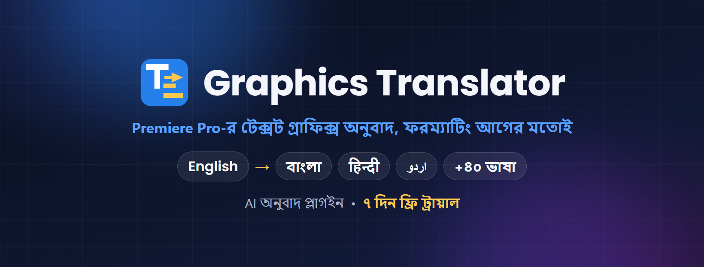

# Graphics Translator — Adobe Premiere Pro plugin

**Premiere Pro-র টেক্সট গ্রাফিক্স এক ক্লিকে হিন্দি, উর্দু, বাংলা ও আরও ৪০+ ভাষায় অনুবাদ — ফন্ট, রং, সাইজ, পজিশন সব আগের মতোই।**

## ⬇️ ডাউনলোড / Download

### [Graphics-Translator.zip — সর্বশেষ ভার্সন (latest version)](https://github.com/ocpabdurrahim/graphics-translator/releases/latest/download/Graphics-Translator.zip)

৭ দিন ফ্রি ট্রায়াল • 7-day free trial
লাইসেন্স কিনতে / To buy a license: **WhatsApp 01912-007750 (+880 1912-007750)** ([chat](https://wa.me/8801912007750))

> শুধু উপরের লিংক থেকে ডাউনলোড করুন। "Source code" ফাইলগুলো প্লাগইন নয়।
> Download only the link above — the "Source code" files on the releases page are not the plugin.

🎙️ **নতুন / New:** [Graphics Voice-over](https://github.com/ocpabdurrahim/graphics-voice-over) — অনুবাদ করা ক্যাপশন থেকে AI ভয়েস-ওভার / AI voice-over from your translated captions.

---

## বাংলা

**যা করে**
- আপনার সিকোয়েন্সের সব টেক্সট গ্রাফিক্স (Type tool) এক ক্লিকে অনুবাদ করে
- ফরম্যাটিং অপরিবর্তিত — বোল্ড টাইটেল বোল্ডই থাকে, রঙিন শব্দ রঙিনই থাকে
- ৪৫+ ভাষা — হিন্দি, উর্দু, বাংলা, আরবি, তামিল, স্প্যানিশ… নিজের ভাষাও যোগ করা যায়
- Google Gemini AI — ফ্রি API কী দিয়ে অটো, অথবা আপনার Gemini অ্যাপ দিয়ে কপি-পেস্ট
- যে শব্দ অনুবাদ হবে না (Timer, ব্র্যান্ড, নাম) — নিজে ঠিক করে দিন
- প্রজেক্ট বানানোর আগে সব অনুবাদ দেখে নিন, দরকার হলে এডিট করুন
- আসল প্রজেক্ট নিরাপদ — প্রতিটা ভাষার জন্য আলাদা নতুন প্রজেক্ট

**যা লাগবে:** Windows • Adobe Premiere Pro 2023 বা নতুন • ইন্টারনেট

**ইনস্টল**
1. zip ফাইলে রাইট ক্লিক > **Extract All** > Extract।
2. Premiere Pro বন্ধ করুন।
3. Extract করা ফোল্ডারে **Install.bat**-এ ডাবল ক্লিক, **Y** চাপুন।
   "Windows protected your PC" দেখালে: **More info > Run anyway**।
4. Premiere Pro-তে: **Window > Extensions > Graphics Translator**।

বিস্তারিত গাইড zip-এর ভেতরে: `README-Bangla.txt`।

**ট্রায়াল ও লাইসেন্স:** প্রথমবার খোলার দিন থেকে ৭ দিন সব ফ্রি। তারপর প্যানেলের Settings > License থেকে পিসি কোড কপি করে WhatsApp-এ পাঠান: **01912-007750 (+880 1912-007750)**। আপনার পিসির জন্য লাইসেন্স কী পাবেন (লাইফটাইম, এক পিসি)।

---

## English

**What it does**
- Translates every text graphic (Type tool) in a sequence in one click
- Keeps the formatting exactly: fonts, colours, sizes, positions, line breaks; bold stays bold, coloured words stay coloured
- 45+ languages: Hindi, Urdu, Bangla, Arabic, Tamil, Spanish… or add your own
- Google Gemini AI: a free API key, or your own Gemini app (copy & paste)
- Keep-list: words like "Timer", brands and names are never translated
- Review and edit every translation before the projects are made
- Your original project is never touched: one new project per language

**Needs:** Windows • Adobe Premiere Pro 2023 or newer • internet

**Install**
1. Right-click the zip > **Extract All** > Extract.
2. Close Premiere Pro.
3. In the extracted folder, double-click **Install.bat** and press **Y**.
   If Windows says "Windows protected your PC": **More info > Run anyway**.
4. In Premiere Pro: **Window > Extensions > Graphics Translator**.

Full guide inside the zip: `README.txt`.

**Trial and license:** everything works for 7 days from the first time you open the panel. Then copy your PC code (Settings > License) and send it on WhatsApp to **01912-007750 (+880 1912-007750)** to buy a lifetime license for that PC.
